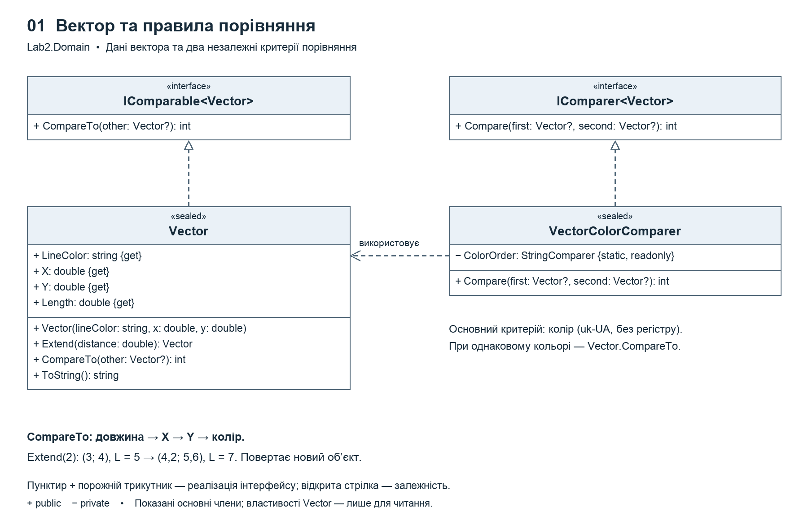
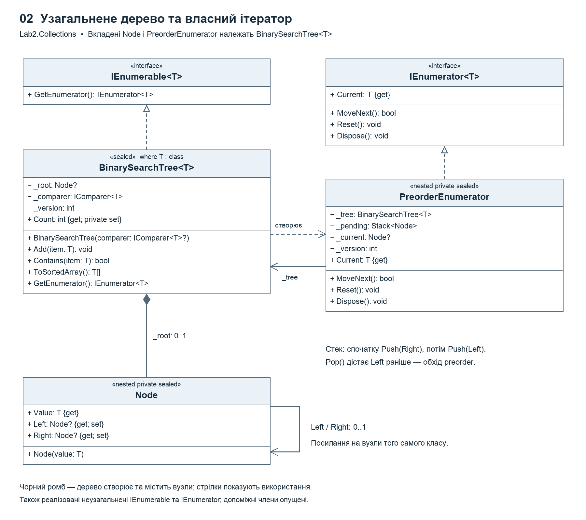
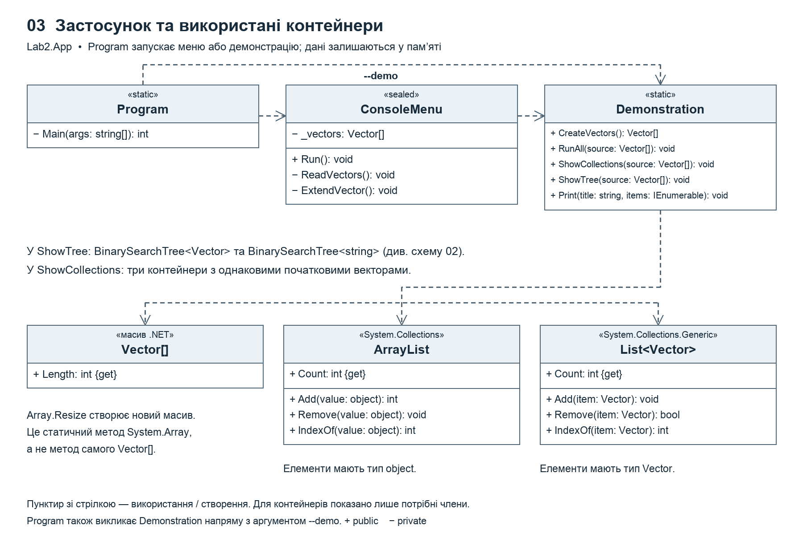

# Колекції та узагальнене бінарне дерево

**Лабораторна робота 3.2 · Об'єктно-орієнтоване програмування · Варіант 7**

[](https://github.com/xand0dev/kai-oop-lab2/actions/workflows/check.yml)

Консольний застосунок на **C# / .NET 8**. Демонструє роботу з векторами в масиві, неузагальненій та узагальненій колекціях, а також у власному бінарному дереві пошуку з прямим обходом **preorder**.

## Завдання

Варіант 7 — двовимірний вектор: колір лінії та координати кінця. Початковий набір містить **3 об'єкти**. Початок вектора прийнято в точці `(0; 0)`.

| Пункт | Реалізація |
| --- | --- |
| Клас за варіантом | `Vector`: довжина, збільшення на відрізок, текстове представлення |
| Масив і колекції | `Vector[]`, `ArrayList`, `List<Vector>`: додавання, видалення, оновлення, пошук, обхід |
| Узагальнене дерево | `BinarySearchTree<T> where T : class`; елементи та вузли є класами |
| Порівняння | `IComparable<Vector>` за довжиною, `IComparer<Vector>` за кольором; `Array.Sort` і `List.Sort` |
| Власний ітератор | `IEnumerable<T>`, `IEnumerator<T>` та їх неузагальнені версії; порядок preorder |

## Запуск

Потрібен **.NET SDK 8**. Підтримуються macOS, Windows та Linux.

```bash
git clone https://github.com/xand0dev/kai-oop-lab2.git
cd kai-oop-lab2
dotnet run
```

| Пункт меню | Дія |
| --- | --- |
| `1` | Повна демонстрація |
| `2` | Ввести свої 3 вектори |
| `3` | Показати поточні вектори |
| `4` | Збільшити вибраний вектор |
| `5` | Операції з масивом і колекціями |
| `6` | Дерево, обхід і сортування |
| `7` | Відновити початковий приклад |
| `0` | Завершити програму |

Числа можна вводити з крапкою або комою. Неправильні значення відхиляються, завершення потоку введення коректно закриває меню.

Повна демонстрація без меню:

```bash
dotnet run -- --demo
```

Збереження виведення стандартними засобами термінала:

```bash
dotnet run -- --demo > output.txt 2> errors.txt
```

## Структура рішення

```text
kai-oop-lab2/
├── Lab2.sln
├── Lab2.csproj                   консольний проєкт
├── Lab2.App/
│   ├── Program.cs                точка входу, UTF-8, режим --demo
│   ├── ConsoleMenu.cs            меню та введення
│   └── Demonstration.cs          демонстрація операцій
├── Lab2.Domain/
│   ├── Vector.cs                 вектор і стандартний порядок порівняння
│   └── VectorColorComparer.cs    порівняння за кольором
├── Lab2.Collections/
│   └── BinarySearchTree.cs       дерево, вкладені вузол та ітератор
└── Lab2.Tests/
    └── Program.cs                16 автоматизованих тестів
```

Консольний проєкт використовує бібліотеки `Lab2.Domain` і `Lab2.Collections`. Бібліотека дерева не залежить від класу вектора: у демонстрації вона також працює з `string`. Правило порівняння можна передати через `IComparer<T>` у конструктор.

## Діаграми класів

### Вектор та правила порівняння



### Дерево та власний ітератор



### Застосунок і контейнери



[Усі три схеми одним PNG](docs/lab2-diagram.png).

Пунктир із порожнім трикутником означає реалізацію інтерфейсу; стрілка — використання або створення іншого об’єкта. Чорний ромб позначає належність вузлів дереву. Показані основні члени; частину допоміжних методів опущено. `Node` і `PreorderEnumerator` — приватні вкладені класи, а не окремі файли.

Для повторного створення зображень потрібні Python 3, Pillow і шрифт Arial або DejaVu Sans:

```bash
python3 tools/build_diagrams.py
```

Готові PNG включені до репозиторію; Python для запуску C#-програми не потрібен.

## Приклад роботи

| Колір | X | Y | Довжина |
| --- | ---: | ---: | ---: |
| Червоний | 3 | 4 | 5 |
| Зелений | 0 | 2 | 2 |
| Синій | 6 | 8 | 10 |

Після збільшення червоного вектора на `2` його координати дорівнюють `(4,2; 5,6)`, а довжина — `7`. Напрямок зберігається.

Дерево для початкового порядку вставки:

```text
        5 (Червоний)
       /           \
  2 (Зелений)   10 (Синій)
```

- **Прямий обхід:** `5 → 2 → 10` — корінь, ліве піддерево, праве піддерево.
- **Сортування за довжиною:** `2 → 5 → 10`.
- **Сортування за кольором:** зелений, синій, червоний.

Сортування повертає окремий набір елементів і не змінює структуру дерева.

## Особливості реалізації

- `Vector` має властивості лише для читання. `Extend` повертає новий об'єкт, тому ключ уже вставленого вектора не змінюється всередині дерева.
- Збільшення нульового вектора на додатний відрізок заборонене, оскільки його напрямок не визначений. Від'ємні відрізки, `NaN`, нескінченність і переповнення відхиляються.
- За однакової довжини вектори порівнюються за X, Y та кольором. Рівні за критерієм елементи дерева зберігаються у правій гілці.
- `IndexOf` у контейнерах шукає переданий екземпляр за посиланням; `Contains` дерева використовує його критерій порівняння.
- Власний ітератор використовує стек, підтримує `MoveNext`, `Current`, `Reset`, `Dispose` і виявляє зміну дерева під час обходу.
- Дерево не самобалансується: вставка й пошук займають O(h), у гіршому випадку O(n). Повний обхід — O(n), додаткова пам'ять ітератора — O(h).
- Для введення та виведення використано UTF-8, `TryParse`, `CultureInfo`, форматування `F2`, перевірку назви кольору через `Regex` і потік `Console.Error`.

Сторонніх NuGet-пакетів немає. `NuGet.Config` вимикає зовнішні джерела: після встановлення SDK рішення збирається без мережі. Для додавання сторонніх пакетів джерело потрібно увімкнути.

## Збірка й тести

```bash
dotnet build Lab2.sln
dotnet run --project Lab2.Tests/Lab2.Tests.csproj
```

Тестовий проєкт є консольним застосунком і запускається через `dotnet run`. Перевіряє формули та валідацію вектора, критерії порівняння, preorder на кількох рівнях, пошук і дублікати, порожнє дерево, стан і незалежність ітераторів, інші типи елементів та вироджене дерево. Помилка тесту дає ненульовий код завершення.

GitHub Actions виконує збірку, всі 16 тестів і повну демонстрацію на Ubuntu та Windows.
